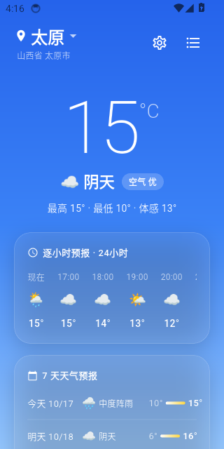
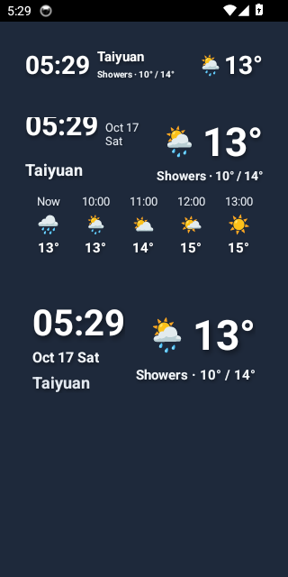

# 初晴天气 (FineWeather)

<p align="center">
  
  &nbsp;&nbsp;&nbsp;&nbsp;
  
</p>

<p align="center">
  <b>一款开源、纯净、优雅、极度轻量的现代化 Android / Flutter 天气应用与桌面微组件</b>
  <br />
  <i>零广告 · 零开屏 · 零隐私追踪 · 全球双源气象冗余容灾 · 全透明桌面小部件</i>
</p>

<p align="center">
  <a href="#-核心特性">核心特性</a> •
  <a href="#-界面预览">界面预览</a> •
  <a href="#-快速下载与安装">下载安装</a> •
  <a href="#-源码构建与开发">本地构建</a> •
  <a href="#-english-documentation">English Docs</a> •
  <a href="#-开源协议-license">开源协议</a>
</p>

<p align="center">
  
  
  
  
</p>

---

## 🌟 核心特性

### 🛡️ 极致纯粹，零商业侵扰
- **零商业广告**：没有开屏广告、没有信息流软文、没有牛皮癣弹窗。
- **无垃圾资讯**：剔除低俗新闻与无效推送，让天气回归纯粹看天气的本质。
- **隐私保护**：无第三方商业统计 SDK，地理位置与偏好设置全本地化存储。

### 🌐 全球双源免 Key 静默容灾 (Dual Redundancy)
- **主数据源**：**Open-Meteo** 全球高精度气象模型（严遵 WMO 世界气象组织规范）。
- **备用数据源**：**wttr.in** 全球开放气象接口。
- **自动故障转移**：主源遇网络波动或超时自动无缝切换备用源，客户端直连开箱即用，无需自建反代或申请商业 Key。

### 📱 原生全透明桌面小部件 (Home Widgets)
- **4×1 单行条形小部件**：实时大时钟、城市名、当前天气状况、温差范围与实时大温度——单行自适应排版，**坚决不换行、不截断、不冒省略号**。
- **4×2 气象看板大部件**：系统实时走日期（如 `10月17日 周六` / `Oct 17 Sat`）、当前天气、温湿体感与 5 节点逐小时预报（首栏带精准 `现在 / Now`）。
- **100% 全透明背景**：白字带精细抗模糊阴影，无论浅色天空、暗色壁纸还是繁复的城市夜景，均清晰锐利。
- **彻底去除应用标签**：桌面小部件彻底抹除多余系统标题与“初晴天气”字样，极简清爽。

### 🧊 莫兰迪清透冰川蓝视觉
- 优雅通透的清润灰蓝莫兰迪基调，搭配毛玻璃卡片（Glassmorphism），视觉轻盈护眼。

### 🌍 中英双语与桌面联动 (i18n)
- 应用内支持 **简体中文** 与 **English** 一键热切换。
- 天气状态描述、星期与日期、生活指标（微风拂面、体感舒适等）与桌面小部件秒级全局联动。

### 📍 本地高精度 GPS 逆地理识别
- GPS 结合 OpenStreetMap 与 BigDataCloud 双通道高精度逆地理编码，精准解析本地真实城市名称。

---

## 📸 界面预览

| 应用主界面 (Main App) | 桌面全透明小部件 (Home Widgets) |
| :---: | :---: |
|  |  |

---

## 🚀 快速下载与安装

前往 GitHub [Releases](https://github.com/sbitoh/fineweather/releases) 页面下载最新 APK：
- **最新版本**：`v0.2.1`
- **支持架构**：`arm64-v8a`, `armeabi-v7a`, `x86_64`

---

## 🛠️ 源码构建与开发

### 环境要求
- Flutter SDK `>=3.3.0`
- Android SDK (API 34/35, JDK 17)

### 构建命令
```bash
# 1. 克隆仓库
git clone https://github.com/sbitoh/fineweather.git
cd fineweather

# 2. 安装依赖
flutter pub get

# 3. 运行调试
flutter run

# 4. 构建发布版 APK
flutter build apk --release
```
编译产物位于 `build/app/outputs/flutter-apk/app-release.apk`。

---

<br />

# 🌐 English Documentation

## 🌟 Highlights & Features

### 🛡️ 100% Pure & Distraction-Free
- **Zero Commercial Ads**: No splash ads, no banner popups, and no sponsored content.
- **No Newsfeeds or Spam**: Stripped of useless clickbait articles and redundant push notifications.
- **Privacy-Respecting**: No third-party tracking SDKs; location and weather data stay strictly local.

### 🌐 Dual Meteorological Sources with Zero-Config Failover
- **Primary Source**: [Open-Meteo](https://open-meteo.com/) high-resolution global weather models (WMO standards).
- **Secondary Source**: [wttr.in](https://wttr.in/) open weather API.
- **Automatic Silent Failover**: Seamlessly fails over to wttr.in if Open-Meteo is temporarily unreachable.

### 📱 Transparent Android Home Screen Widgets
- **4×1 Compact Ribbon**: Bold clock, localized city name, real-time temperature, condition status, and high/low range—engineered for single-line display with **zero text-wrapping or clipping**.
- **4×2 Weather Dashboard**: Real-time clock with synchronized live date display (e.g. `Oct 17 Sat`), weather summary, and a 5-step hourly forecast timeline starting with `Now`.
- **100% Transparent Background**: Crisp white typography with subtle drop shadows, ensuring legibility across any wallpaper.
- **Clean Aesthetic**: Completely free of unnecessary application branding or system widget label clutter.

### 🧊 Glacial Glassmorphism Aesthetics
- Elegant Morandi cool-blue palette paired with soft glassmorphic cards and balanced whitespace for comfortable, strain-free viewing.

### 🌍 Seamless Bilingual Support (i18n)
- One-tap instant toggle between **English** and **Simplified Chinese (简体中文)**.
- Weather conditions, weekdays, dates, lifestyle metrics (*Gentle Breeze, Comfortable, Clear View*), and home widgets synchronize instantly.

### 📍 Localized Smart Geocoding
- Real-time GPS location with reverse geocoding via OpenStreetMap and BigDataCloud channels, accurately resolving the real local city name.

---

## 📄 开源协议 (License)

本项目基于 [Apache License 2.0](LICENSE) 协议开源。

开发者：**sbitoh**
